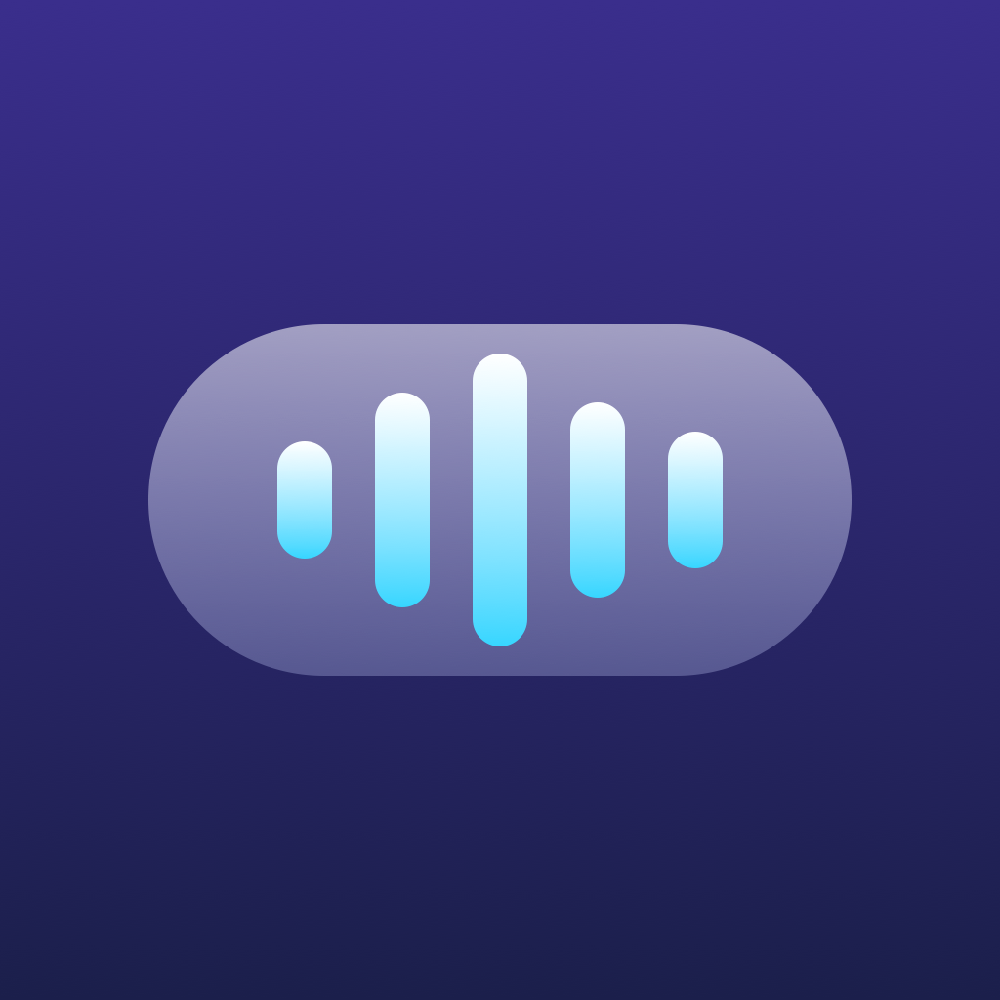
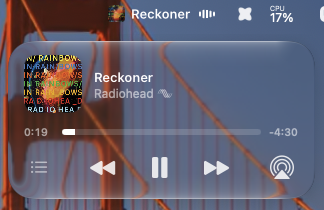
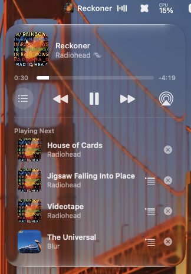
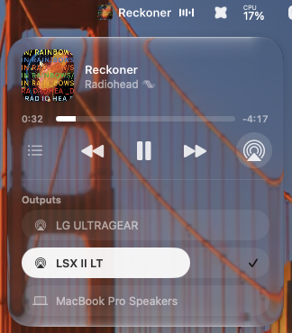

<p align="center">
  
</p>

# LiquidBar

**A free, open-source Liqoria decomp for macOS 26.** LiquidBar rebuilds
[Liqoria](https://www.liqoria.com)'s **menu bar preview** and its **Liquid Glass
media player** in native Swift, working from how the original app behaves and
how its binary is put together.

## Why

The menu bar player is the kind of thing that should simply be part of Apple
Music's own mini player on the Mac. Until it is, it should at least be free
and open, so anyone can use it, read how it works, and improve it.

## Status

LiquidBar does what I need today: the menu bar preview and the glass player,
with queue, AirPlay outputs and audio-quality badges (all listed below). No
floating player, no accounts, no analytics. About 1,500 lines of Swift plus a
200-line Objective-C bridge.

If it gets some attention and downloads, the next step is porting the rest of
Liqoria's settings (marquee speed, panel size and style, the other player
modes, and so on). Star the repo or open an issue to say which ones you want.

| Player | Playing Next | Outputs |
| :---: | :---: | :---: |
|  |  |  |
| Hover the menu bar item: artwork, scrolling title and live waveform open into the glass player. | The player's own queue: play, move up next, remove or drag to reorder. | Switch the Mac's audio output and set its volume. |

## Run it

```bash
Scripts/build-app.sh release --run
```

That builds `build/LiquidBar.app` (ad-hoc signed) and launches it. Requires
macOS 26 and Xcode 26 or later.

- **Hover** the menu bar item to open the player; move away to close it.
- **Click** the item to pin the player open until you click elsewhere.
- **Two-finger swipe** sideways over the item or the card to change track;
  **swipe up** on the card to dismiss it.
- **Audio quality**: a Lossless (also Hi-Res Lossless) or Dolby Atmos mark
  after the artist when the player reports one.
- **Queue button** (left): "Playing Next" from the player's own queue. Click
  a song to play it, the play-next arrow to move it up next, × to remove it,
  or drag any row up or down: the list reorders under the pointer and the
  player gets the new order on drop. Dropping outside the list puts it back.
  Two-finger swipe left on a row removes it, right moves it to play next.
- **AirPlay button** (right): "Outputs", the Mac's audio devices. Click one to
  switch to it; drag across the selected one to set its volume.
- **Liquid Glass slider**: the player follows the system setting in System
  Settings > Appearance, crisp glass toward Clear and frosted toward Tinted,
  and picks up the current value every time it opens.
- **Right-click** the item for Open on Hover, Open at Login and Quit.

## License and credits

LiquidBar is released under the [MIT License](LICENSE).

It is an independent project, not affiliated with or endorsed by Liqoria or
its developer. No code or assets from Liqoria are included: everything here
was written from scratch. If you want the full app with all its players and
settings today, buy [Liqoria](https://www.liqoria.com) and support its developer.
